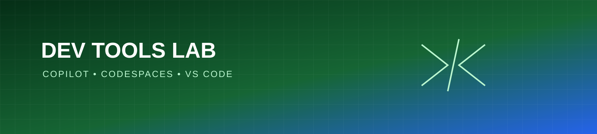

# Developer Tools Learning Lab

A practical learning repository for exploring GitHub Copilot, Codespaces, Visual Studio Code workflows, AI-assisted development, and modern developer productivity tools.

## Focus areas

- Reproducible development environments
- AI-assisted coding with human review
- Effective editor and terminal workflows
- Documentation, testing, and maintainable project habits

## Status

This repository will evolve through guided exercises and small experiments.
